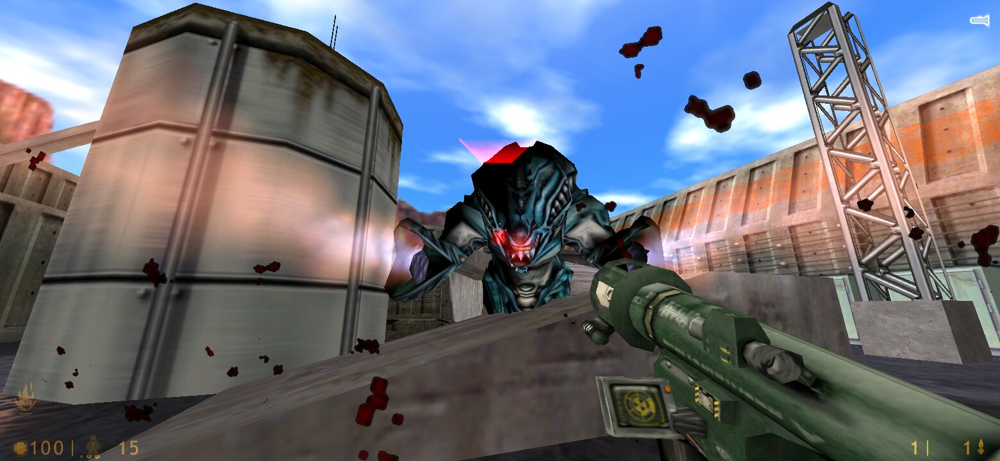
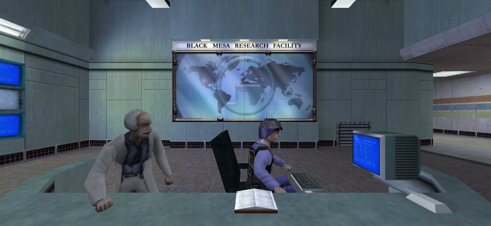
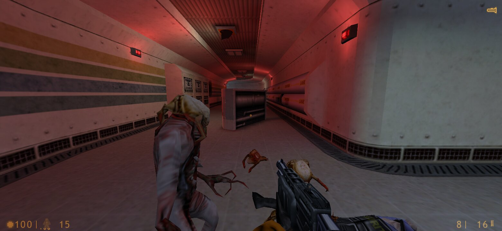
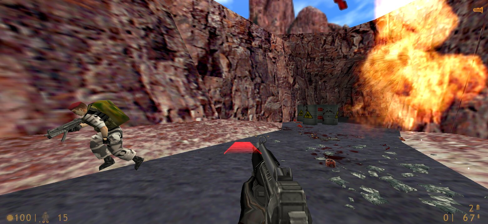
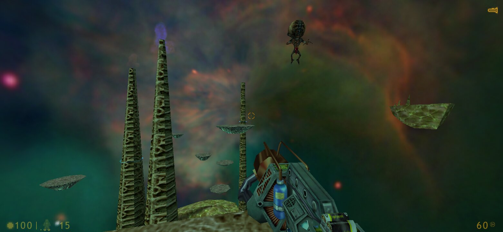
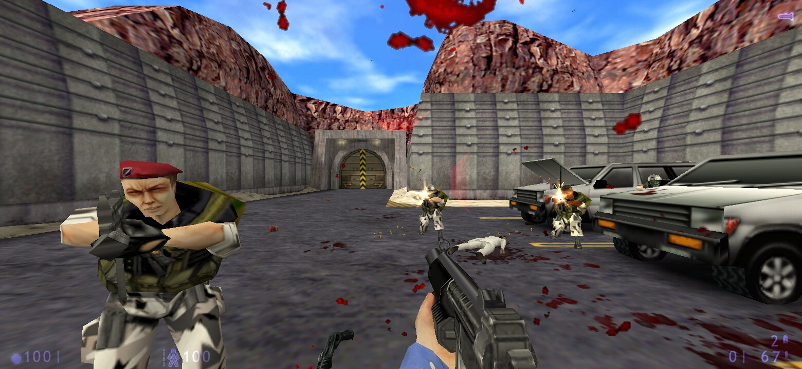
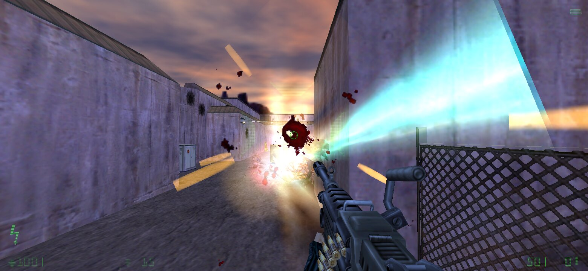

# Half-Life for iPhone: Half-Life, Opposing Force and Blue Shift (Xash3D FWGS)

Play **Half-Life** (1998) and its expansions **Half-Life: Opposing Force** and **Half-Life: Blue Shift** on iPhone, with touch controls, in one app. It's an unofficial port of [Xash3D FWGS](https://github.com/FWGS/xash3d-fwgs), the open-source engine that runs Half-Life, with the game code from [hlsdk-portable](https://github.com/FWGS/hlsdk-portable). Half-Life co-op, deathmatch modes and Counter-Strike 1.6 are in there too, as experimental extras.



**You need your own copy of the games (Steam). Game files are not included.** Buy [Half-Life](https://store.steampowered.com/app/70/HalfLife/) on Steam, and if you like [Opposing Force](https://store.steampowered.com/app/50/HalfLife_Opposing_Force/), [Blue Shift](https://store.steampowered.com/app/130/HalfLife_Blue_Shift/) or [Counter-Strike](https://store.steampowered.com/app/10/CounterStrike/). Then copy their folders to your iPhone.

## Install

You need an iPhone with iOS 12 or newer (iOS 18 or newer for the Metal graphics). The app isn't on the App Store, so you install it yourself ("sideloading"). Pick one way:

- **SideStore or AltStore (easiest).** On your iPhone, tap **[Add to SideStore](https://sithewok13-dev.github.io/half-life/#add-sidestore)** or **[Add to AltStore](https://sithewok13-dev.github.io/half-life/#add-altstore)**, then install **Half-Life** from there. Updates come the same way.
- **Feather, Sideloadly or another signing tool.** Download `Xash3D-iOS-unsigned.ipa` from the [releases page](https://github.com/sithewok13-dev/xash3d-fwgs/releases) and sign it with your tool.
- **The source by hand.** In SideStore, AltStore or Feather, go to *Sources*, tap **+**, and paste this address:

  ```
  https://raw.githubusercontent.com/sithewok13-dev/xash3d-fwgs/master/scripts/ios/altstore-source.json
  ```

Then open the app once, and copy the game folders from your Steam copy (`valve`, and `gearbox`, `bshift` or `cstrike` if you have them) into **Files › On My iPhone › Half-Life**. [Step by step](https://github.com/sithewok13-dev/xash3d-fwgs/blob/master/Documentation/ios-release-notes.md#install)

AltStore here means AltStore Classic; AltStore PAL can't install it. The *iOS latest* build on the releases page is the newest test build, made after every change and not yet tried by anyone.

## Cool features

- **Three games, one app:** Half-Life, Opposing Force and Blue Shift, picked on a *Choose a game* screen that says which folders it found.
- **Touch controls** built for a phone: a move stick wherever your left thumb lands, drag anywhere to aim, FIRE, ALT fire, JUMP, DUCK, USE, RELOAD and a flashlight button.
- **A weapon wheel:** slide your thumb from NEXT WPN and pick any weapon by its icon, with its ammo shown.
- **Quick save and quick load** with a short hold, so a stray tap never loses your progress.
- **Metal graphics** on iOS 18 and newer, at **60 or 120 frames a second**.
- **Tilt aiming** with the gyro, if you like it.
- **A camera:** photos, selfies with the characters near you, bursts, and **Action Freeze**, which stops the game so you can fly a camera round the moment.
- **A cheat** (`sithewok`): god mode, every weapon, noclip, and a chapter list to jump anywhere in the game.
- **Experimental extras:** Half-Life **co-op** for up to 4 players, **Multiplayer Modes** (deathmatch, team deathmatch, capture the flag, gun game and more, with the free Adrenaline Gamer mod's files), and **Counter-Strike 1.6** with your own Steam copy.

[Every control explained](https://github.com/sithewok13-dev/xash3d-fwgs/blob/master/Documentation/ios-release-notes.md#how-to-play-every-control-explained)

## Sorry about the bugs

This is an unofficial beta, made by one fan and tested on one iPhone. Expect bugs, and back up your saves.

**Multiplayer is the least finished part.** Co-op, Multiplayer Modes and Counter-Strike have had very little testing, and playing between two devices, over Wi-Fi or Tailscale, may not work yet. Finding games on your Wi-Fi by itself doesn't work for now, so join by address. Sorry: it needs more work.

Found a bug? [Report it here](https://github.com/sithewok13-dev/xash3d-fwgs/issues), not to the Xash3D FWGS developers. Every report helps.

<p>






</p>

*All the pictures come from the same engine and game code running on a computer, not from an iPhone, so they show no touch controls. Some scenes were set up with the game's console (god mode, monsters placed by hand).*

## Thanks

This port stands on other people's work, and it wouldn't exist without them. Thank you:

- **Uncle Mike** (Unkle Mike), who wrote the original [Xash3D engine](https://www.moddb.com/engines/xash3d-engine).
- **The Flying With Gauss (FWGS) team**, who made [Xash3D FWGS](https://github.com/FWGS/xash3d-fwgs) and keep it going: [Alibek Omarov (a1batross)](https://github.com/a1batross), [mittorn](https://github.com/mittorn), [nekonomicon](https://github.com/nekonomicon), [Velaron](https://github.com/Velaron), [SNMetamorph](https://github.com/SNMetamorph) and [all its contributors](https://github.com/FWGS/xash3d-fwgs/graphs/contributors). You can [support them here](https://github.com/FWGS/xash3d-fwgs/blob/master/Documentation/donate.md).
- **The [hlsdk-portable](https://github.com/FWGS/hlsdk-portable) contributors**, for the game code of all three games.
- **Valve**, for Half-Life and for releasing its SDK, and **Gearbox Software** for Opposing Force and Blue Shift.
- **BulliT (Martin Webrant)** for Adrenaline Gamer, **Velaron** for [cs16-client](https://github.com/Velaron/cs16-client), and the [ReGameDLL_CS](https://github.com/rehlds/ReGameDLL_CS) contributors.
- **[SDL](https://github.com/libsdl-org/SDL)** and **[ANGLE](https://github.com/google/angle)**, which this app runs on.

None of them made this port, and none of its bugs are theirs.

Not affiliated with or endorsed by Valve or Gearbox Software, and not an official Xash3D FWGS release.

---

*The rest of this page is upstream Xash3D FWGS's README, by the Flying With Gauss team and the Xash3D FWGS contributors, from [FWGS/xash3d-fwgs](https://github.com/FWGS/xash3d-fwgs). Its links point to upstream; for the iPhone port, see above.*

> [!CAUTION]
> **Only download Xash3D FWGS from official sources.** Third-party builds, "modded launchers", "optimized" repacks and random mirrors are frequently bundled with malware, miners, spyware and credential stealers. We cannot vouch for anything we did not build. Get official binaries only from the [releases page](https://github.com/FWGS/xash3d-fwgs/releases/tag/continuous).

# Xash3D FWGS Engine 
[](https://github.com/FWGS/xash3d-fwgs/actions/workflows/c-cpp.yml) [](https://cirrus-ci.com/github/FWGS/xash3d-fwgs) \
[](http://xash.su/discord/) [](https://t.me/flyingwithgauss) \
[](https://github.com/FWGS/xash3d-fwgs/releases/tag/continuous)

Xash3D ([pronounced](https://ipa-reader.com/?text=ks%C9%91%CA%82) `[ksɑʂ]`) FWGS is a game engine, aimed to provide compatibility with Half-Life Engine and extend it, as well as to give game developers well known workflow.

Xash3D FWGS is a heavily modified fork of an original [Xash3D Engine](https://www.moddb.com/engines/xash3d-engine) by Unkle Mike.

## Donate
[](Documentation/donate.md) \
If you like Xash3D FWGS, consider supporting individual engine maintainers. By supporting us, you help to continue developing this game engine further. The sponsorship links are available in [documentation](Documentation/donate.md).

## Fork features
* Steam Half-Life (HLSDK 2.5) support.
* Crossplatform and modern compilers support: supports Windows, Linux, BSD & Android on x86 & ARM and [many more](Documentation/ports.md).
* Better multiplayer: multiple master servers, headless dedicated server, voice chat, [GoldSrc protocol support](Documentation/goldsrc-protocol-support.md) and IPv6 support.
* Multiple renderers support: OpenGL, GLESv1, GLESv2 and Software.
* Advanced virtual filesystem: `.pk3` and `.pk3dir` support, compatibility with GoldSrc FS module, fast case-insensitivity emulation for crossplatform.
* Mobility API: better game integration on mobile devices (vibration, touch controls).
* Different input methods: touch and gamepad in addition to mouse & keyboard.
* TrueType font rendering, as a part of mainui_cpp.
* External VGUI support module.
* PNG & KTX2 image format support.
* Ogg Vorbis (`.ogg`) & Ogg Opus (`.opus`) audio formats support.
* [A set of small improvements](Documentation/), without broken compatibility.

## Installation & Running
0) Get Xash3D FWGS binaries: you can use [testing](https://github.com/FWGS/xash3d-fwgs/releases/tag/continuous) build or you can compile engine from source code.
1) Copy engine binaries to some directory.
2) Copy `valve` directory from [Half-Life](https://store.steampowered.com/app/70/HalfLife/) to directory with engine binaries.
If your CPU is NOT x86 compatible or you're running 64-bit version of the engine, you may want to compile [Half-Life SDK](https://github.com/FWGS/hlsdk-portable).
This repository contains our fork of HLSDK and restored source code for Half-Life expansions and some mods.
You still needed to copy `valve` directory as all game resources located there.
3) Run the main executable (`xash3d.exe` or AppImage).

For additional info, run Xash3D with `-help` command line key.

### Android
0) Install the APK file.
1) Copy `valve` directory to a folder named `xash` in the Internal storage.
2) Run games from within the app.

## Reporting issues
* Issues are accepted in both English and Russian.
* They are only accepted if you run legally acquired product (e.g. Half-Life in Steam).

## Contributing code
* Check the CONTRIBUTING.md file.

## Build instructions
We are using Waf build system. If you have some Waf-related questions, I recommend you to read [Waf Book](https://waf.io/book/).

**NOTE: NEVER USE GitHub's ZIP ARCHIVES. GitHub doesn't include external dependencies we're using!**

### Prerequisites
If your CPU is x86 compatible and you're on Windows or Linux, we are building 32-bit code by default. This was done to maintain compatibility with Steam releases of Half-Life and based on it's engine games.
Even if Xash3D FWGS does support targetting 64-bit, you can't load games without recompiling them from source code!

If your CPU is NOT x86 compatible or you decided build 64-bit version of engine, you may want to compile [Half-Life SDK](https://github.com/FWGS/hlsdk-portable).
This repository contains our fork of HLSDK and restored source code for Half-Life expansions and some mods.

#### Windows (Visual Studio)
* Install Visual Studio.
* Install latest [Python](https://python.org) **OR** run `cinst python.install` if you have Chocolatey.
* Install latest [Git](https://git-scm.com/download/win) **OR** run `cinst git.install` if you have Chocolatey.
* Download [SDL2](https://libsdl.org/download-2.0.php) development package for Visual Studio.
* Clone this repository: `git clone --recursive https://github.com/FWGS/xash3d-fwgs`.
* Make sure you have at least 12GB of free space to store all build-time dependencies: ~10GB for Visual Studio, 300 MB for Git, 100 MB for Python and other.

#### GNU/Linux
##### Debian/Ubuntu
* Only for 32-bit engine on 64-bit x86 operating system:
  * Enable i386 on your system: `$ sudo dpkg --add-architecture i386`.
  * Install `aptitude` ([why?](https://github.com/FWGS/xash3d-fwgs/issues/1828#issuecomment-2415131759)):  `$ sudo apt update && sudo apt upgrade && sudo apt install aptitude`
  * Install development tools: `$ sudo aptitude --without-recommends install git build-essential gcc-multilib g++-multilib libsdl2-dev:i386 libfreetype-dev:i386 libopus-dev:i386 libbz2-dev:i386 libvorbis-dev:i386 libopusfile-dev:i386 libogg-dev:i386`.
  * Set PKG_CONFIG_PATH environment variable to point at 32-bit libraries: `$ export PKG_CONFIG_PATH=/usr/lib/i386-linux-gnu/pkgconfig`.

* For 64-bit engine on 64-bit x86 and other non-x86 systems:
  * Install development tools: `$ sudo apt install git build-essential python libsdl2-dev libfreetype6-dev libopus-dev libbz2-dev libvorbis-dev libopusfile-dev libogg-dev`.

* Clone this repostory: `$ git clone --recursive https://github.com/FWGS/xash3d-fwgs`.

##### RedHat/Fedora
* Only for 32-bit engine on 64-bit x86 operating system:
  * Install development tools: `$ sudo dnf install git gcc gcc-c++ glibc-devel.i686 SDL3-devel.i686 sdl2-compat-devel.i686 opus-devel.i686 freetype-devel.i686 bzip2-devel.i686 libvorbis-devel.i686 opusfile-devel.i686 libogg-devel.i686 libatomic.i686`.
  * Set PKG_CONFIG_PATH environment variable to point at 32-bit libraries: `$ export PKG_CONFIG_PATH=/usr/lib/pkgconfig`.

* For 64-bit engine on 64-bit x86 and other non-x86 systems:
  * Install development tools: `$ sudo dnf install git gcc gcc-c++ SDL3-devel sdl2-compat-devel opus-devel freetype-devel bzip2-devel libvorbis-devel opusfile-devel libogg-devel`.

* Clone this repostory: `$ git clone --recursive https://github.com/FWGS/xash3d-fwgs`.

#### Android (Windows/Linux/macOS)
* Install [Android Studio](https://developer.android.com/studio) (or the command line tools).
* Install [Python](https://python.org) (at least 2.7, latest is better).
* Install [Git](https://git-scm.com/download/win).
* Install [Ninja](https://ninja-build.org/).
* Install [CMake](https://cmake.org/) (for some dependencies).

* Clone this repostory: `$ git clone --recursive https://github.com/FWGS/xash3d-fwgs`.

#### iOS/iPadOS
* Install Xcode from the appstore.
* Install [Homebrew package manager](https://brew.sh).

* Install build dependencies by running: `brew install python`.

* Clone the SDL2 repo `$ git clone --recursive https://github.com/libsdl-org/SDL.git -b SDL2` and compile the iOS framework by navigating to SDL/Xcode/SDL and opening the Xcode project.

* Clone this repository: `$ git clone --recursive https://github.com/FWGS/xash3d-fwgs`.

### Building
#### Windows (Visual Studio)
0) Open command line.
1) Navigate to `xash3d-fwgs` directory.
2) (optional) Examine which build options are available: `waf --help`.
3) Configure build: `waf configure --sdl2=c:/path/to/SDL2`.
4) Compile: `waf build`.
5) Install: `waf install --destdir=c:/path/to/any/output/directory`.

#### Linux
If compiling 32-bit on amd64, make sure `PKG_CONFIG_PATH` from the previous step is set correctly, prior to running configure.

0) (optional) Examine which build options are available: `./waf --help`.
1) Configure build: `./waf configure` (you need to pass `-8` to compile 64-bit engine on 64-bit x86 processor).
2) Compile: `./waf build`.
3) Install: `./waf install --destdir=/path/to/any/output/directory`.

#### Android (Windows/Linux/macOS)
To build you should clone [SDL](https://github.com/libsdl-org/SDL) from `SDL2` branch and [HLSDK-portable](https://github.com/FWGS/hlsdk-portable) `mobile-hacks` branch repositories to 3rdparty folder, after that you should be able to open the project in Android Studio from `android` directory or manually call Gradle to build the APK.

#### iOS/iPadOS (MacOS only)
0) (optional) Examine which build options are available: `./waf --help`.
1) Configure build: `./waf configure --ios --enable-bundled-deps --sdl2 (path/to/SDL2.framework)`, set `--ios-simulator` instead of `--ios` if you want to build for simulator.
2) Compile `./waf build`.
3) Navigate to `build` and copy your compiled SDL2.framework there, then add your game dylibs to `build/ios/libs/(gamedir)/(dlls/cl_dlls)`(You can also run `scripts/ios/buildhlsdk.sh` instead to automatically create an ipa with hlsdk dylibs)
4) Run `scripts/ios/createipa.sh` to create an installable ipa

### Running tests

Tests are enabled with `--enable-tests` passed to `./waf configure` and can be run with `./waf --alltests`.

This builds both standalone unit tests and a separate engine test binary (`xash3d_tests`) that embeds engine-level tests. The engine test binary requires no game assets.
